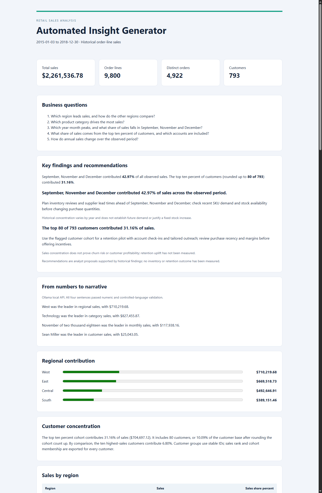
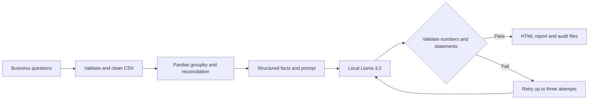

# Automated Retail Sales Insight Generator

A reproducible data analyst portfolio project that turns Pandas sales summaries into a short business narrative using **Llama 3.2 through local Ollama**, validates every generated statement, and exports an HTML report with supporting tables and audit evidence.



## Findings from the supplied dataset

The source contains **9,800 order lines**, **4,922 orders**, and **793 customers**, covering **January 2015–December 2018**. Total observed sales are **$2,261,536.78**. Currency is assumed to be USD for this US retail example; the source does not explicitly specify it.

| Business question | Computed finding | Business use |
| --- | --- | --- |
| Which region drives sales? | West leads with **$710,219.68**; South has **$389,151.46**, the lowest regional total | Investigate regional product mix and market coverage before allocating resources |
| Which category drives sales? | Technology leads with **$827,455.87** | Review availability and product mix; margins are unavailable |
| Which month has the highest sales? | **November 2018**, with **$117,938.16** | Investigate historical demand patterns before making inventory decisions |
| How concentrated are sales by season? | **September, November and December contribute 42.97% (about 43%)** of sales across 2015–2018 | Plan inventory reviews and supplier lead times ahead of these months; validate current SKU demand before changing purchase quantities |
| Which customers matter most? | The **top 10% of customers contribute 31.16% (about 31%)** of sales: **80 of 793 customers**, rounding the cohort count up | Use the flagged cohort for targeted retention outreach; check recency and margins before offering incentives |
| How do annual sales change? | Observed 2018 sales are **$722,052.02**, up **20.30%** from 2017 | Compare sales trajectories after checking reporting coverage |

These are descriptive findings from the attached file. The dataset does not establish why sales changed, measure profitability, or support a claimed business uplift. No reporting-time savings were measured.

The seasonal share is pooled across the full period, not 43% every year: the yearly shares range from **39.76% to 47.45%**, as exported in `reports/seasonality_summary.csv`. The months were selected during exploratory analysis; this is historical concentration, not a statistical test or forecast. The top-10% cohort uses `ceil(0.10 × 793) = 80` customers (10.09% after rounding); `reports/customer_summary.csv` includes each customer's sales rank and cohort flag. This differs from the **top ten individual customers**, who contribute **6.80%**.

The proposed actions are documented in the report and `reports/recommendations.json`. They are recommendations, not implemented interventions or measured business outcomes.

## Before and after

**Before: Pandas output** (`reports/metrics.json`, retaining source precision)

```json
{
  "top_region": {"label": "West", "sales": 710219.6845, "tied_leaders": 1},
  "top_category": {"label": "Technology", "sales": 827455.873, "tied_leaders": 1},
  "top_month": {"label": "2018-11", "sales": 117938.155, "tied_leaders": 1},
  "top_customer": {"label": "Sean Miller", "sales": 25043.05, "tied_leaders": 1}
}
```

**After: actual validated Llama 3.2 output** (`reports/narrative.txt`)

> West was the leader in regional sales, with $710,219.68.
> Technology was the leader in category sales, with $827,455.87.
> November of two thousand eighteen was the leader in monthly sales, with $117,938.16.
> Sean Miller was the leader in customer sales, with $25,043.05.

The model chooses among approved sentence alternatives. Constrained wording makes entity, ranking, currency and numeric validation enforceable; this is intentionally a narrow narration task. Each sentence has exactly one numeric amount. The year is spelled out to retain the complete reporting period. The model performs no arithmetic.

## How it works



1. Define five business questions before calculating metrics.
2. Parse dates explicitly as **day/month/year**. Retain and flag **11 missing postal codes**; preserve leading zeros. Verify **zero exact duplicate rows** and unique Row IDs. Repeated Order IDs are legitimate order lines.
3. Calculate regional, category, year-month, calendar-month, customer and annual sales with Pandas. Reconcile full-population groupings to total sales; calculate selected-month concentration by year and top-10% customer concentration from their matching denominators.
4. Build a small fact dictionary and a specific four-sentence prompt. Round only display amounts, using explicit decimal half-up rounding.
5. Generate structured JSON through Ollama's local API, using `llama3.2:3b`.
6. Extract each sentence's numeric token and compare it with the expected Decimal value. Reject wrong entities, rankings, currencies, extra claims or extra numbers using approved sentence forms.
7. Publish only after validation succeeds. Export the report, summary tables, prompt, raw model response, input hash and validation results.

The function `run_report()` wraps the entire workflow. Failed model generation raises an error; it never silently substitutes template text. A separate, visibly labeled template mode supports offline previews and tests.

## Run locally

Requires Python 3.13 and [Ollama](https://ollama.com/). The provided raw dataset is available locally in `data/train.csv`; it is excluded from Git because a redistribution license was not supplied. After cloning, place the same file there to reproduce the attached-data findings. See [data notes](data/README.md).

```powershell
python -m venv .venv
.venv\Scripts\python -m pip install -r requirements.txt
ollama pull llama3.2:3b
# Start Ollama if it is not already running:
ollama serve
```

In a second terminal, run:

```powershell
.venv\Scripts\python insight_generator.py --input data/train.csv --output reports
.venv\Scripts\python -m unittest discover -s tests -v
```

Open `reports/report.html` in your browser. The saved sample was generated by the installed `llama3.2:3b` model, with its actual response and successful checks recorded in `reports/run.json`. CPU inference is configured because the local accelerated runner crashed during verification. A first run may take longer while loading the model.

For a no-model preview, use a separate output folder:

```powershell
.venv\Scripts\python insight_generator.py --mode template --output reports/preview
```

From Python:

```python
from insight_generator import run_report

report_path = run_report("data/train.csv", "reports", model="llama3.2:3b")
```

## Deliverables

| File | Purpose |
| --- | --- |
| `insight_generator.py` | Reusable analysis, local model integration, validation and HTML generation |
| `reports/report.html` | Standalone business report with key findings, actionable recommendations, regional bars and seven supporting tables |
| `reports/metrics.json` | Computed headline metrics at source precision |
| `reports/*_summary.csv` | Regional, category, year-month, calendar-month, customer, annual and yearly seasonal summaries |
| `reports/recommendations.json` | Analyst recommendations with source findings and interpretation limits |
| `reports/narrative.txt` | Actual accepted model output |
| `reports/prompt.txt` | Exact prompt used for the accepted output |
| `reports/run.json` | Input SHA-256, timestamp, data quality, model metadata, response and checks |
| `tests/` | Synthetic offline tests and optional attachment-specific regression checks |
| `.github/workflows/tests.yml` | Automated tests on pushes and pull requests |
| `docs/METHODOLOGY.md` | Definitions, validation scope, rounding, assumptions and limitations |
| `docs/RESUME_AND_INTERVIEW.md` | ATS-friendly resume bullets, interview answers and GitHub upload steps |

## Verification

**37 tests passed locally**: 31 offline tests and six dataset regression tests. Existing tests now include seasonal denominators, years without selected-month sales, customer cohort rounding and tie boundaries, exported cohort membership, and recommendation output. CI runs without the raw attachment or Ollama; the six dataset tests are skipped when the CSV is absent. Tests also cover cleaning, reconciliation, identity consistency, annual growth, rounding, corrupted narratives, model failures and output generation. Independent Decimal controls over the raw CSV verify total sales of **2261536.7827**, the **42.97%** seasonal share and **31.16%** customer concentration.

Validation is strict for the four approved LLM claims. It is not a general-purpose fact checker or an accuracy benchmark. Seasonal concentration, customer concentration, and annual growth are presented directly from Pandas; recommendations are analyst-authored proposals linked to those findings. Existing successful output remains if a later run fails; inspect the timestamp and input hash before treating it as refreshed.

## Automation and GitHub

Rerun the same command against updated data. To schedule it in Windows Task Scheduler, select the virtual environment's Python executable, pass `insight_generator.py --input data/train.csv --output reports`, and set **Start in** to the project folder. Ollama must be available under the scheduled account. No scheduled task was installed.

The project is prepared for GitHub upload; no remote has been configured or pushed. The raw dataset is excluded, and its acquisition and version requirements are documented. See [publication steps and resume entry](docs/RESUME_AND_INTERVIEW.md). The sample outputs retain customer labels from the attachment, so review redistribution rights before publication.

## Technical references

The local request follows the official [Ollama generate API](https://docs.ollama.com/api/generate) and [structured output documentation](https://docs.ollama.com/capabilities/structured-outputs). Analysis definitions and project-specific assumptions are documented in [methodology](docs/METHODOLOGY.md).
